<div align="center">

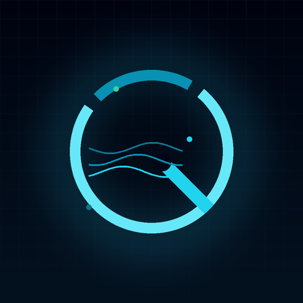

# QuantWeave

**把研究，变成可复现的决策。**

一个面向 A 股的开源量化研究工作台：数据更新、因子回测、缠论结构、趋势排名、日/分时模型、纸上账户与运行审计，收在同一个深色界面里。

[](https://www.python.org/)
[](https://flask.palletsprojects.com/)
[](LICENSE)
[](#-30-秒跑起来)

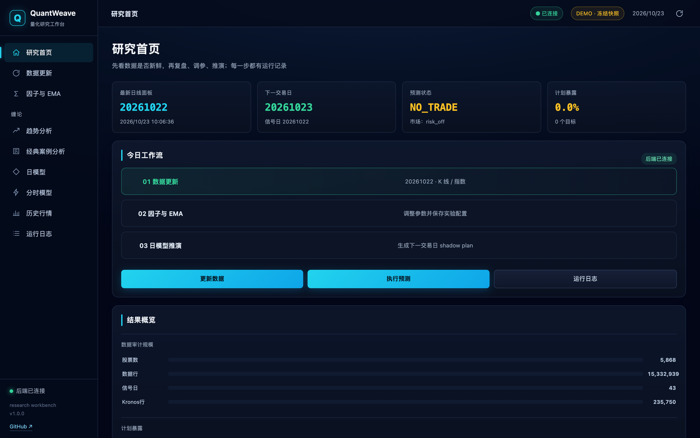

</div>

> **Demo first.** 仓库自带一份脱敏、冻结的行情快照。克隆后不需要行情账号、GPU 或模型权重，一条命令就能看到完整界面和交互。

---

## 🚀 30 秒跑起来

```bash
git clone https://github.com/DWJLULALA/QuantWeave.git
cd QuantWeave
python3 -m venv .venv && source .venv/bin/activate   # Windows: .venv\Scripts\activate
pip install -r requirements-demo.txt
python demo_server.py --port 7072
```

打开 <http://127.0.0.1:7072>。右上角的 `DEMO · 冻结快照` 标记表示当前运行在零数据演示模式。

或者用 Docker：

```bash
docker build -t quantweave-demo .
docker run --rm -p 7072:7072 quantweave-demo
```

---

## 为什么是 QuantWeave

大多数量化项目停在「一个 notebook + 一张收益曲线」。真正每天要用的时候，缺的往往是另一半：

- **数据是不是最新的？** 哪一天缺了、哪只票没对齐、盘中 bar 收完没有；
- **这个结论是怎么来的？** 参数、成本、门控、信号日、失效条件能不能复原；
- **结构有没有偷看未来？** 笔、中枢、递归线段在「当时」是否已经确认；
- **跑完的东西在哪？** 日志、CSV、快照、失败原因，能不能一键回看。

QuantWeave 把这些做成一套可操作的工作台：**每一次点击都有任务、有进度、有产物、有记录。**

---

## 产品一览

### 1. 研究工作台 · 一条日常流水线

首页把「数据更新 → 因子与 EMA → 日模型推演」串成当天的工作流，并直接给出最新面板日期、下一交易日、预测状态与计划暴露。

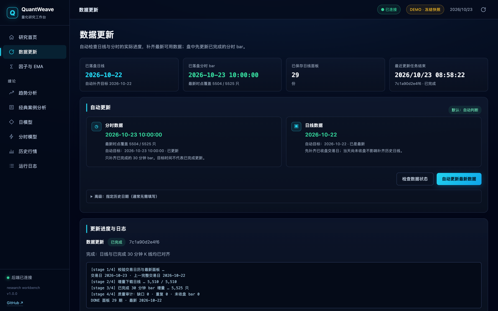

- 日线与 30 分钟 bar 分开检查，只补**已收盘**的 bar；
- 任务有阶段进度、实时日志和退出码，长任务不会被刷新页面弄丢；
- 数据能力（更新 / 复盘 / 因子 / 预测 / 分时 / 缠论 / 趋势）由后端逐项探测，不可用就明说原因。

### 2. 因子与 EMA 实验室 · 因果回测，不是「曲线拟合」

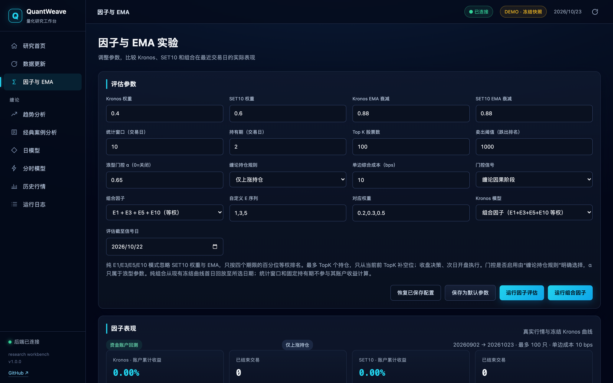

- Kronos、SET10、EMA 与自定义 E 序列可组合，权重、持有期、TopK、退出排名、门控 α、单边成本全部显式；
- 回测引擎 `causal_cash_book_v2`：信号次日开盘成交、现金账本、手续费、涨跌停/停牌约束，**不使用未来数据**；
- 结果同时给出账户曲线、逐日回撤、实际敞口、IC、换手与分组表现；
- 组合因子把日模型与分时分数做横截面标准化，输出带稳定性的 TopK 与次日预测均值。

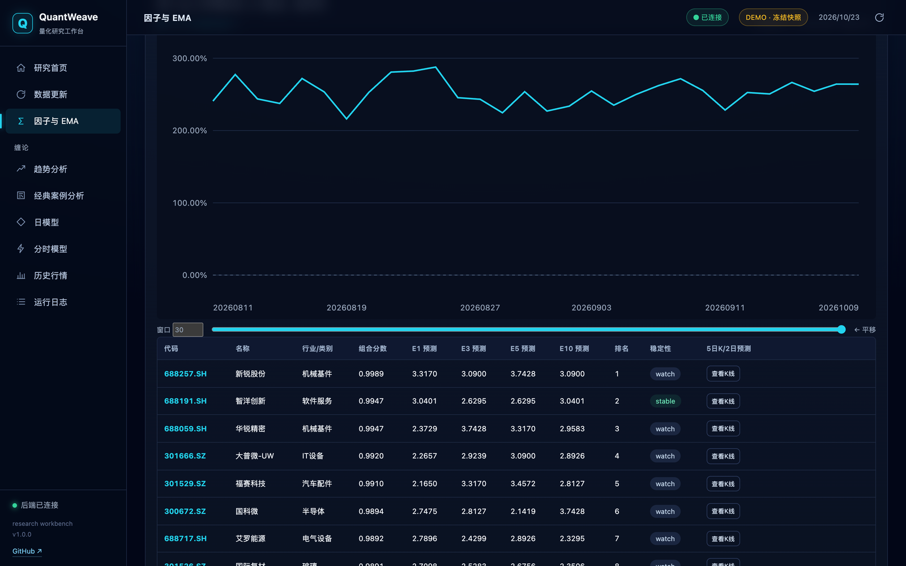

### 3. 趋势分析 · 把「结构」画在图上

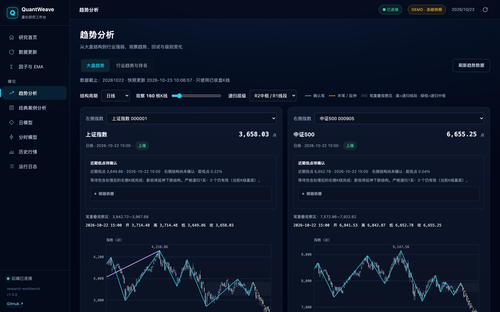

- 上证 / 沪深 300 / 中证 500 双图对照，日 / 周 / 月结构周期可切换；
- 分型、笔、中枢、递归线段（R0 → R1 → R2+）逐层绘制，**实线=已确认，虚线=延伸候选**；
- 缠论阶段、P(推动浪)、120 日位置、相对强弱同屏对照；
- 行业榜覆盖申万 2021 一级 31 类 / 二级 134 类，另有中证全指行业 10 类。

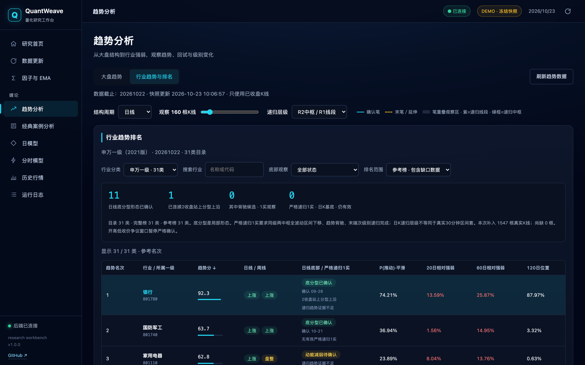

趋势分是固定展示规则，不是校准过的上涨概率：

```text
score = 100 × [0.40×结构分 + 0.30×P平滑 + 0.20×RS20分位 + 0.10×RS60分位]
结构分 = (0.7×日线阶段 + 0.3×周线阶段 + 1) / 2
```

- P 由道氏结构、Supertrend、ADX、Choppiness、均线排列、20 日动量、推动计数**七票**构成；
- ZigZag 事后浪段只做灰色复盘，**不进入 P、不进入排名**；
- 严格递归 1 买单独标注：R2+ 中枢、b/c 背驰、c 段新低、末端次级别双中枢；R1 笔级只记候选。

### 4. 经典案例分析 · 逐 bar 回放，承认「当时不知道」

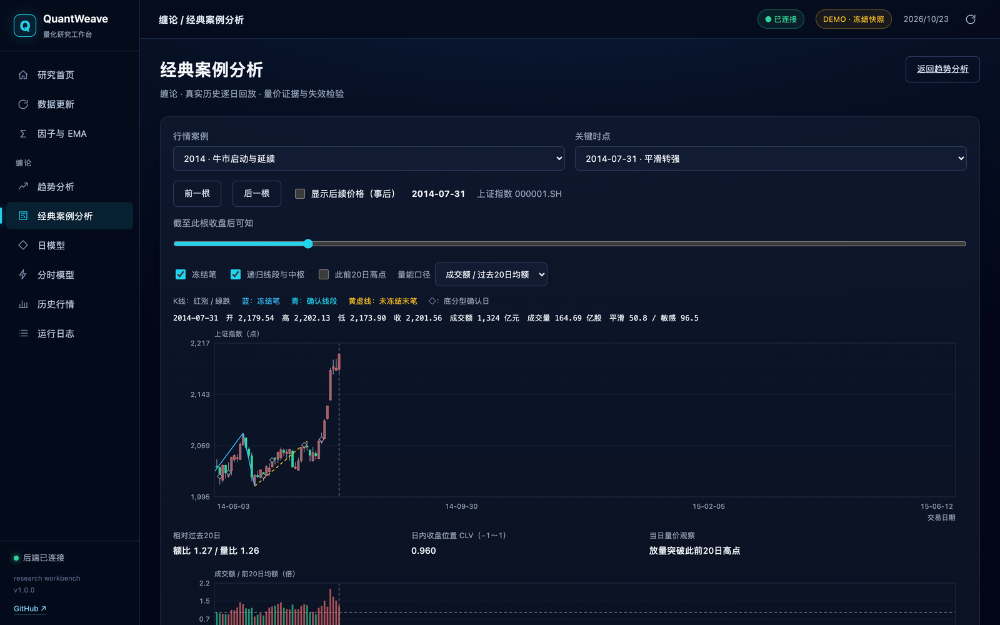

- 2014 牛市启动、2015 见顶、2018 下跌等真实上证片段；
- 拖动时间轴，只显示「截至于此收盘」可知的笔、线段、中枢；
- 量比、额比以**不含当日**的过去 20 日均值为基线；
- 每个案例都同时展示「后来发生了什么」，但不会把事后价格塞回当时的结构判断。

### 5. 日模型 · 冠军工作簿与风控闸门

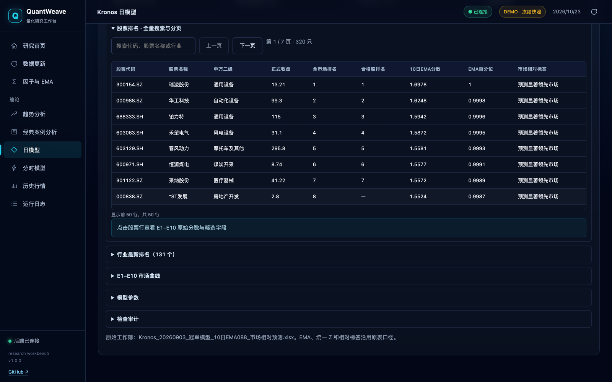

- 5,000+ 只股票按 10 日 EMA 分数、E1–E10 统一 Z、全市场排名、申万二级分类呈现；
- 支持代码 / 名称 / 行业搜索与服务端分页；
- 日模型输出「下一交易日目标」；当市场状态为 `risk_off`、策略未过入场门槛时，明确给出 `NO_TRADE` 与 **0% 计划暴露**，而不是硬凑持仓。

### 6. 分时模型 · 预测路径 + 行业相对强度 + 纸上账户

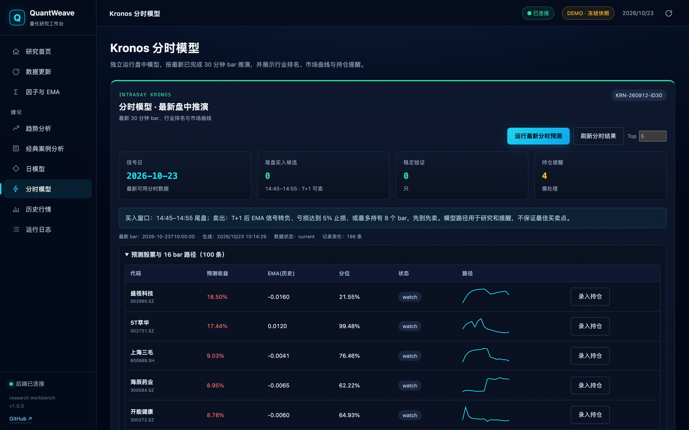

- 按最新**已收盘** 30 分钟 bar 推演，输出 16 bar 预测路径、EMA 历史、分位与状态；
- 行业排名、市场曲线、IC 趋势、持仓提醒在同一页；
- 卖出规则写死在界面上：T+1 后可卖、EMA 转负、亏损 5% 止损、最多持有 8 bar，先到先卖。

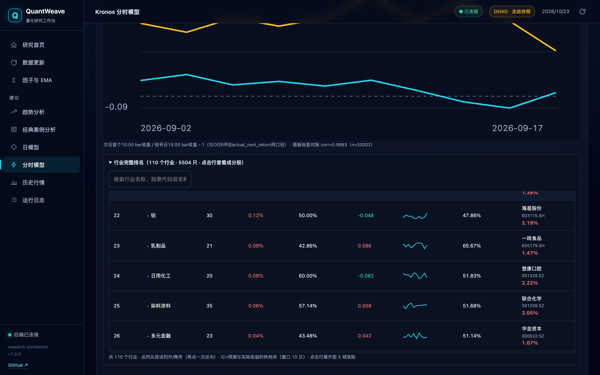

- 纸上账户支持录入、取消、卖出、重置本金；
- 本金 / 现金 / 持仓市值 / 总资产 / 已实现盈亏 / 胜率 / 盈亏比实时重算；
- **只做研究记录，不连接任何实盘下单接口。**

### 7. 历史行情 · 涨停、连板与成交热度

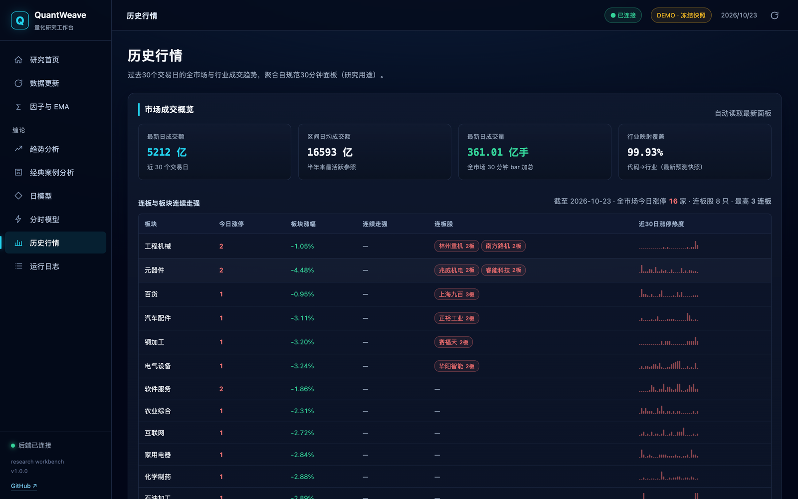

- 近 30 个交易日全市场与行业成交额、成交量、行业映射覆盖率；
- 涨停 / 连板 / 板块连续走强榜，附 30 日涨停热度迷你图；
- 个股 K 线弹窗可查看 OHLC 与模型 horizon。

### 8. 运行日志与产物中心 · 可追溯是底线

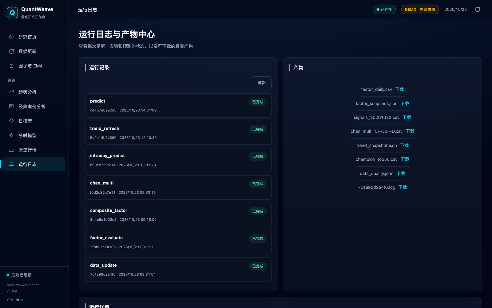

- 任务状态、阶段、进度、退出码、日志尾部统一展示；
- 产物（CSV / JSON / 日志）可直接下载；
- 后端只接受**白名单任务类型**，命令以 argv 数组执行，不经过 shell；运行记录与产物落在 `runs/<job_id>/`。

---

## 🧠 工程亮点

| 亮点 | 实现 |
|---|---|
| **因果回测** | `factor_evaluate.py` 的现金账本引擎：次日开盘成交、费用、门控与暴露逐日记录；`causal_cash_book_v2` |
| **严格递归缠论** | `chan_core.py` → `chan_multi_engine.py` → `strict_chan.py`：包含处理、分型、笔、中枢、背驰、逐层冻结；`strict_events.py` 只追加事件账本 |
| **不偷看未来** | 分型等待右邻合并 K 线收盘；R1+ 只消费已冻结子结构；ZigZag 事后浪段与排名隔离 |
| **多级别验证** | 5F–30F–D / 30F–D–W / D–W–M 三组合，walk-forward balanced accuracy 与混淆矩阵 |
| **趋势可解释** | 固定权重分数 + 七票 P + 结构分 + 相对强弱分位；缺日、补源、争议全部显式列出 |
| **任务编排** | `app.py` 内置监督器：argv 白名单、`.exit.json` 原子退出记录、阶段解析、日志轮询、同类型任务复用 |
| **零数据演示** | `demo_server.py` 复用同一套 `templates/` + `static/`，以冻结快照和模拟任务还原全部交互 |
| **可移植** | 所有私有路径、主机名、账号、解释器路径已移除；真实模式通过 `KRONOS_ROOT` / `STOCKLAB_*` 环境变量接入 |

---

## 🏗 架构

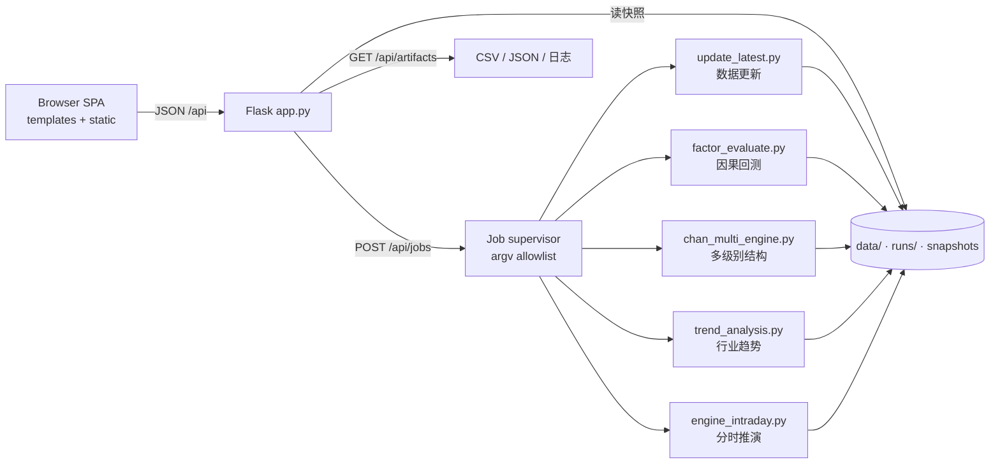

数据侧的主链路：

```text
行情源 ──► 日线 / 30F 面板 (parquet)
              ├─► factor_evaluate ──► 因子快照 + 逐日曲线
              ├─► chan_core / chan_multi ──► 结构 + 阶段 + 验证
              ├─► trend_analysis ──► 行业/宽基排名快照
              └─► engine_intraday ──► 分时候选 + 预测路径
Kronos 模型 ──► 日/分时预测 ──► composite_factor ──► 冠军工作簿
所有产物 ──► Flask API ──► 前端
```

更细的模块职责与 API 契约见 [docs/ARCHITECTURE.md](docs/ARCHITECTURE.md) 与 [docs/API.md](docs/API.md)。

---

## 📁 目录

```text
QuantWeave/
├── app.py                  # Flask API + 任务监督器（真实模式）
├── demo_server.py          # 零数据演示服务器（冻结快照）
├── update_latest.py        # 日线 / 面板更新
├── update_intraday_*.py    # 30 分钟 bar 增量
├── factor_evaluate.py      # 因果回测引擎
├── composite_factor.py     # 日模型 × 分时分数合成
├── chan_core.py            # 单级别缠论因果引擎
├── chan_multi_engine.py    # 三级别拼装 / walk-forward
├── strict_chan.py          # 严格递归 1 买
├── trend_analysis.py       # 趋势分 / 行业排名 / 快照
├── classic_cases.py        # 历史案例回放
├── engine_intraday.py      # 分时推演
├── market_snapshot.py      # 个股 OHLC / horizon
├── templates/ static/      # 前端（无构建步骤）
├── chan_vendor/            # vendored chan.py（MIT，保留版权）
├── demo/                   # 脱敏冻结快照 + 演示产物
├── docs/                   # 架构 / API / 模型 / 宣传片脚本
└── test_*.py               # 单元测试
```

前端是原生 HTML/CSS/JS + 内联 SVG，没有 npm、没有打包器。改完刷新即可看到效果。

---

## 🔧 真实模式

演示模式之外，QuantWeave 也可以接到自己的研究环境：

```bash
pip install -r requirements.txt

export KRONOS_ROOT=/path/to/Kronos
export STOCKLAB_PROJECT_ROOT="$KRONOS_ROOT"
export QUANTWEAVE_PYTHON="$(which python)"
export STOCKLAB_HOST=127.0.0.1
export STOCKLAB_PORT=7070

python app.py
```

关键环境变量：

| 变量 | 作用 | 默认 |
|---|---|---|
| `KRONOS_ROOT` / `STOCKLAB_PROJECT_ROOT` | 上游 Kronos 研究目录 | `/opt/kronos` |
| `STOCKLAB_RUN_ROOT` | 任务日志与产物 | `./runs` |
| `STOCKLAB_CONFIG` | 面板配置 | `./config.json` |
| `STOCKLAB_*_PYTHON` | 各任务解释器 | 当前解释器 |
| `QUANTWEAVE_API` | 流水线脚本回调的面板地址 | `http://127.0.0.1:7070` |

真实模式需要自备行情数据（日线、30 分钟面板、指数与申万行业序列）和模型权重。仓库**不附带**任何行情数据、模型权重或账号凭据。

---

## 🧪 测试

```bash
pip install -r requirements-demo.txt
python -m unittest test_demo_server -v
```

演示层测试覆盖首页、状态、趋势与详情、工作簿裁剪、产物下载、纸上账户、任务生命周期与 404。也可以直接 `make test`。

GitHub Actions 模板在 [`docs/ci.example.yml`](docs/ci.example.yml)：复制到 `.github/workflows/ci.yml` 即可启用（首次推送需要 token 带 `workflow` 权限）。

算法层的测试（`test_chan_*.py`、`test_strict_*.py`、`test_trend_*.py`、`test_composite_*.py` 等）需要 `requirements.txt` 与本地研究数据，按需运行：

```bash
python -m unittest test_strict_chan test_trend_analysis test_trend_api -v
```

---

## 🎬 宣传片

[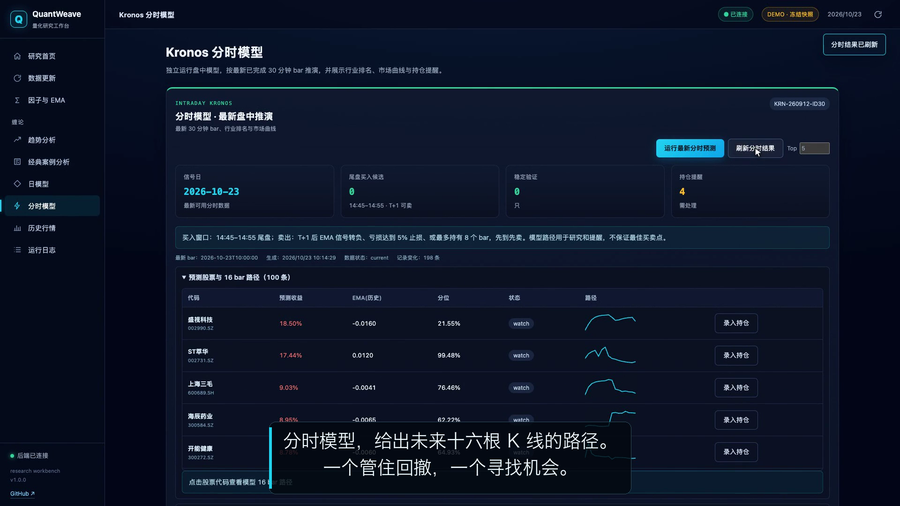](docs/media/quantweave-promo.mp4)

- **2 分 09 秒 · 1080p · 男声旁白 + 中文字幕 + 真实操作录屏**：[docs/media/quantweave-promo.mp4](docs/media/quantweave-promo.mp4)
- 镜头脚本 / 旁白 / 剪辑参数：[docs/VIDEO_STORYBOARD.md](docs/VIDEO_STORYBOARD.md)

镜头依次走过：数据更新 → 因子与组合 → 趋势与周线 → 行业排名 → 缠论经典案例 → 日模型风控 → 分时 16 bar → 纸上账户 → 涨停热度 → 运行日志与产物。

宣传片全部画面来自本仓库的 `demo_server.py`，用 Playwright 录下真实的点击、输入、滚动、运行任务与持仓录入，不包含任何真实账号、持仓或私有路径。

---

## 📚 文档

| 文档 | 内容 |
|---|---|
| [ARCHITECTURE.md](docs/ARCHITECTURE.md) | 分层、模块职责、任务生命周期、数据契约 |
| [API.md](docs/API.md) | 前端使用的全部 API、字段、示例 |
| [MODELS.md](docs/MODELS.md) | 因子回测、缠论递归、趋势分、日/分时模型口径 |
| [CHAN_MULTI_LEVEL.md](docs/CHAN_MULTI_LEVEL.md) | 5F–30F–D / 30F–D–W / D–W–M 设计 |
| [STRICT_CHAN.md](docs/STRICT_CHAN.md) | 申万补缺与严格递归 1 买规则 |
| [TREND_ANALYSIS.md](docs/TREND_ANALYSIS.md) | 趋势分、P、相对强弱、数据质量 |
| [DEMO.md](docs/DEMO.md) | 冻结快照如何生成、裁剪与脱敏 |
| [PRIVACY.md](docs/PRIVACY.md) | 脱敏范围与安全边界 |
| [VIDEO_STORYBOARD.md](docs/VIDEO_STORYBOARD.md) | 宣传片镜头表与旁白 |

---

## ⚖️ 许可与声明

- 本项目代码以 [MIT](LICENSE) 发布。
- `chan_vendor/` 来自 [chan.py](https://github.com/Vespa314/chan.py)，固定提交 `429d6ed3043e27c93a003ba2b10e70a05575e1f5`，遵循其 MIT 许可，版权归原作者所有，详见 `chan_vendor/LICENSE` 与 `chan_vendor/UPSTREAM.json`。
- Kronos 模型是独立的上游项目，需遵循其自身许可；本仓库不包含模型权重。
- 所有界面、快照和示例仅用于**研究与教学**，不构成任何投资建议。历史表现不代表未来收益。
- 仓库不包含真实账号、个人信息、内网地址、SSH 配置或行情授权凭据。

---

## English

**QuantWeave** is an open-source research workbench for A-share quant workflows: data updates, causal factor backtests, recursive Chan-theory structure, industry trend ranking, daily/intraday model review, a paper account, and run/artifact auditing — all in one dark dashboard.

The repository ships a **zero-data demo**: frozen, sanitized snapshots and simulated jobs. Run `python demo_server.py --port 7072` and open <http://127.0.0.1:7072>. No market-data account, GPU, or model weights required.

- Flask + vanilla JS, no frontend build step.
- Causal backtests, no look-ahead; recursive Chan structures frozen at the time they were knowable.
- MIT licensed. Research and education only — not investment advice.
